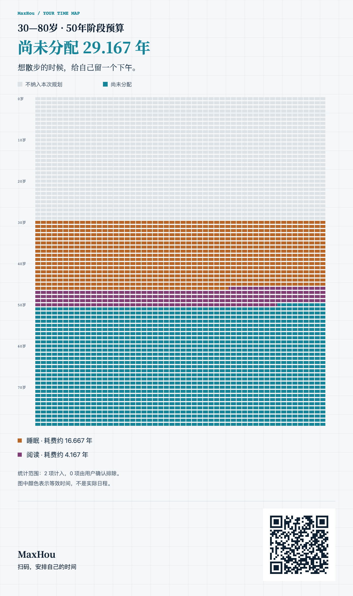

# 人生计算器 / Life Calculator · v2.0


把日常与想做的事放进同一份时间预算，看看还剩多少空间。选一个人生阶段，填入活动，生成一张可以保存、分享的时间图谱。

**[直接体验 →](https://maxhou.cn/static/life-calculator/index.html)** · 无需注册 · 纯前端 · PNG 导出

*Life Calculator visualizes daily routines and personal pursuits within a stage you choose. Plans stay in your browser; export a PNG to keep or share the result.*

LifeGrid 80 是仓库标识；产品名称是「人生计算器 / Life Calculator」。

## 看看效果



以上为真实测试导出的 **示例数据**，不是个人测算。[查看完整 PNG](docs/images/samples/normal-quote-one.png) · [20 项活动示例](docs/images/samples/twenty-activities.png) · [官网实际导出示例](docs/images/samples/actual-online-png.png)。这些是迁移前的效果参考，不是本仓库回归已通过的证明。

## 能做什么

- **三步算清预算**：选定阶段 → 16 项常见日常活动（不填不扣）→ 自己想做的探索。先用月看日常后的余量，再用年看探索后的余量。
- **修改后再确认**：草稿与正式报告分开，点击「生成时间图谱」才确认。默认持续年数随阶段变化，也能手填年数并保留。
- **看见分配与问题**：稳定的活动身份与 24 色基础配色；可缩放、滚动的时间图谱；错误、明确排除、超配和待修正都有提示。
- **保存真实 PNG**：醒目的尚未分配年数、简洁的活动等效年数、轮换的 20 句原创短句，以及本地生成的固定官网二维码。网页明细可查看小时。

## 三步上手

1. **选阶段**：例如 26—80 岁，预算为 54 年。起止年龄支持 0—120 岁、最多一位小数，终点可修改。
2. **填日常**：例如睡眠每天 7 小时，其余模板留空。展开某项可设置持续年数。
3. **添探索并生成**：例如阅读每天 2 小时，全阶段持续，尚未分配 **33.75 年**；生成后可导出 PNG。把起点改为 30 岁，两项默认持续年数随之变为 50 年，尚未分配 **31.25 年**；再次生成才更新正式报告。

## 本地运行

已在仓库根目录时，无需安装运行时依赖：

```bash
python3 -m http.server 4173 --bind 127.0.0.1
```

浏览器打开 `http://127.0.0.1:4173/index.html`。保持相同地址和端口，才能继续访问同一份本机规划。用完在终端按 `Ctrl+C` 停止；也可用 `npm start` 启动同样的本地服务。

## 怎么理解结果与隐私

- 预算是选定阶段 **L − S**，不是从今天开始的寿命预测，也不是日历排程。每年近似 **52 周 = 364 天 = 8736 小时**，每月 **728 小时**；合计使用未取整小时，显示时才四舍五入。
- 80 年是默认展示假设，不是强制终点。颜色是等效时间比较；「尚未分配」也不保证现实里一定可自由支配。超配会提示，不静默裁剪；不可计算旧项需补全或明确排除。
- 规划保存在当前 **origin（协议、主机、端口）的 localStorage**。没有账号或云同步；清理浏览器数据、无痕窗口关闭或存储失败都可能丢失。**PNG 不能恢复可编辑规划**，首次迁移备份也仍在同一浏览器内。
- 计算与 PNG 生成在浏览器内完成，二维码只含固定官网链接，不带测算参数。网页仍会加载资源：当前使用 Google Fonts 的 Noto Serif SC（失败时回退本机字体）；访问官网、字体服务或导航可产生网络请求及服务端访问记录。不能理解为网页零网络请求。

更多口径、迁移规则和依赖说明见 [开发说明](docs/DEVELOPMENT.md)。

## 开发与测试

需要 Node.js 20+、npm、Python 3；浏览器验收使用已安装的 Google Chrome。依赖固定在项目本地：

```bash
npm ci --no-audit --no-fund
npm test
npm run test:native
```

`npm test` 运行 Node 模型、存储和事件契约测试；`test:native` 在正常 Mac Shell 中运行 Node、完整浏览器 E2E 与实际完整 PNG 的独立 QR 解码，结果写入 gitignored 的 `artifacts/local-v2/`。Chrome 使用临时独立 context，启用 sandbox，不读取用户 profile 或存储。不应把受限沙箱无法启动浏览器当作通过。

分步运行、证据边界与验收结果见 [测试说明](docs/TESTING.md)。

## 更新历史与许可

v2.0 整合三步规划、阶段预算、草稿确认、旧数据兼容与 PNG 分享。[CHANGELOG](CHANGELOG.md) 保留 V1.0 / V1.1 的历史记录；版本号不代表已创建 GitHub Release。

延续原仓库声明的 [MIT License](LICENSE)。二维码库 qrcode-generator 2.0.4 保留[原 MIT 许可证](vendor/qrcode-generator-LICENSE.txt)；完整依赖与致谢见 [THIRD_PARTY_NOTICES](THIRD_PARTY_NOTICES.md)。
